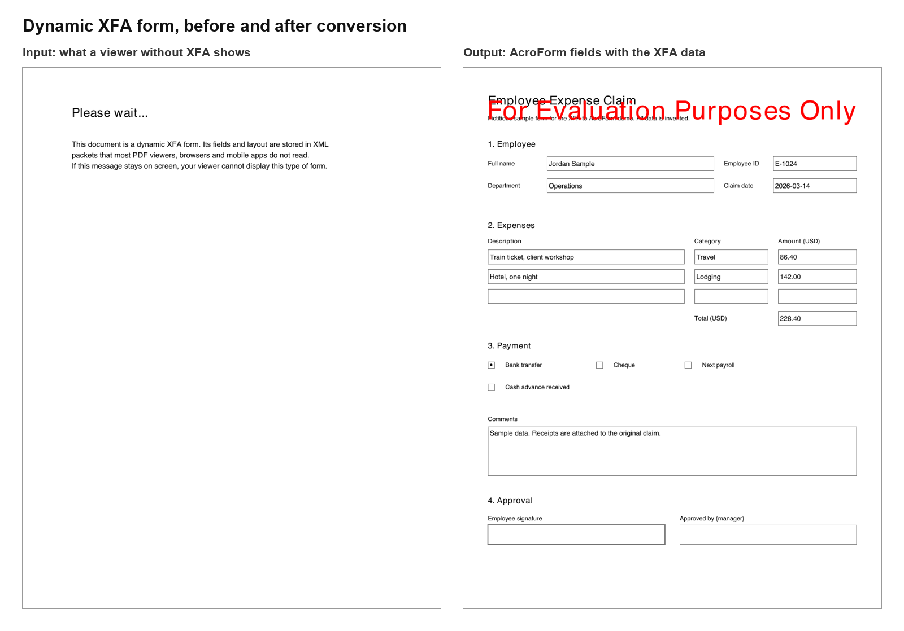
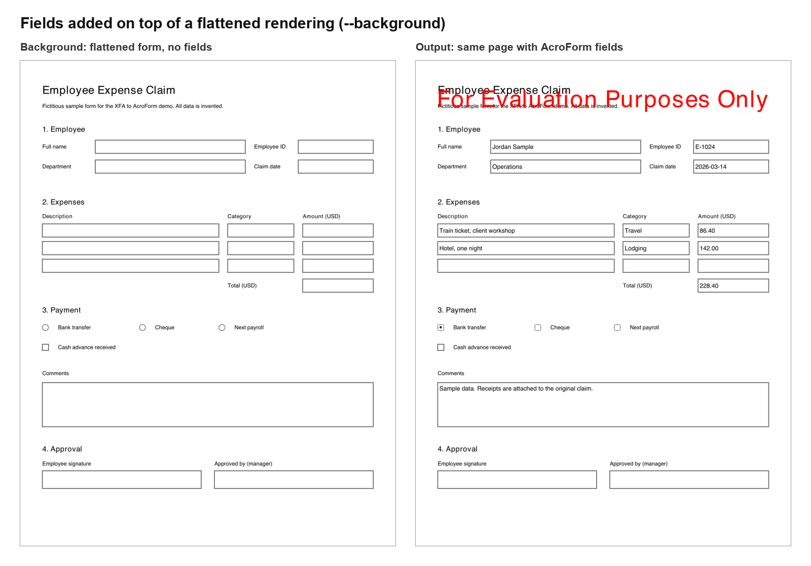

# Nutrient XFA to AcroForm

A Nutrient.io demo that converts XFA PDF forms into standard AcroForm PDFs with GdPicture.NET, so that viewers without XFA support, such as the Nutrient Web SDK, browsers and mobile apps, can show and fill them.



*Rendered with Poppler. The output was written in evaluation mode, hence the watermark.*

1. **Read the XFA packets.** The template and data packets are read from `/AcroForm /XFA` with [PdfPig](https://github.com/UglyToad/PdfPig) (Apache-2.0). GdPicture can detect and remove XFA, but has no API to read it. Files that PdfPig cannot parse are scanned for compressed XFA streams.
2. **Static or dynamic.** GdPicture opens the PDF.
   - Static XFA forms already contain AcroForm fields. The converter removes the XFA packets with `RemoveXFAFormFieldsData` and keeps the fields.
   - Dynamic XFA forms only contain a placeholder page ("Please wait..."). The converter continues with the next steps.
3. **Layout.** The template is laid out on pages: positioned subforms, top-to-bottom and left-to-right flows, page breaks, subform margins, and caption reserves.
4. **Page content.** The placeholder is cleared, and the static text of the template (draw elements and field captions) is drawn on the pages.
5. **Fields.** One AcroForm field is created per XFA field, with the value from the XFA data packet, the items of drop-downs, the radio groups, the read-only and required flags, and the tooltip.

Everything runs locally. No cloud service is called.

## Field mapping

| XFA `ui` | AcroForm field |
|---|---|
| `textEdit`, `numericEdit`, `dateTimeEdit`, `passwordEdit` | Text field (multi-line kept) |
| `checkButton` | Check box |
| `checkButton` in an `exclGroup` | Radio button group |
| `choiceList` | Combo box, or list box when `open="always"` or `"multiSelect"` |
| `signature` | Signature field |
| `button` | Push button (its caption becomes the button face) |
| `imageEdit`, `barcode` | Not converted (warning) |

| XFA property | AcroForm |
|---|---|
| Value in the data packet, or the template default | Field value (`--no-values` leaves fields empty) |
| `access="readOnly"`, `"protected"`, `"nonInteractive"` | Read-only |
| `<validate nullTest="error">` | Required |
| `<assist><toolTip>`, otherwise the caption | Tooltip |
| `maxChars` | Maximum length |
| `presence="hidden"`, `"invisible"`, `"inactive"` | Not converted |

## Limitations

- XFA scripts (JavaScript and FormCalc) are not converted.
- Repeating subforms and tables that grow with data are laid out once.
- Fields on master pages (`pageArea`) are not converted.
- Long forms with flowing, conditional sections are laid out approximately. When the exact look matters, print the form to PDF from an XFA viewer and pass it with `--background`: the fields are then added on top of that rendering.

## Prerequisites

- .NET SDK 8 or later (the project targets .NET 8)
- Windows, macOS or Linux
- To regenerate the samples: Python 3 with `reportlab` and `pypdf`.

## Environment variables

Keys are only read from environment variables, never from code. Start from `.env.example`.

| Variable | Purpose | Default |
|---|---|---|
| `GDPICTURE_LICENSE_KEY` | GdPicture.NET license key | empty = evaluation mode |

In evaluation mode GdPicture stamps a watermark on every PDF it writes. The conversion works the same.

## Build and run

Run these from the repository root.

```bash
dotnet build XfaToAcroForm
```

```bash
set -a && source .env && set +a && dotnet run --project XfaToAcroForm -- samples/expense-claim-xfa.pdf
```

The result is written to `output/expense-claim-xfa_acroform.pdf`.

## Usage

```text
XfaToAcroForm <input.pdf> [output.pdf] [options]
XfaToAcroForm --dir <input-folder> <output-folder> [options]
```

| Option | Effect |
|---|---|
| `--background`, `-b <pdf>` | Add the fields on top of this flattened rendering of the form |
| `--no-values` | Do not copy the XFA data into the fields |
| `--rebuild` | Static XFA forms: delete the existing fields and recreate them from the template |
| `--keep-content` | Dynamic XFA forms: keep the placeholder page content |
| `--verbose`, `-v` | Print every field found, with its page, position and value |
| `--dir`, `-d` | Convert every PDF of a folder |

Without an output path the result goes to `output/<input name>_acroform.pdf`.

```text
Converting expense-claim-xfa.pdf
  Form       : dynamic XFA
  Fields     : 21 created of 21 found
                12 Text
                 4 ComboBox
                 3 RadioButton
                 1 CheckBox
                 1 Signature
  Output     : output/expense-claim-xfa_acroform.pdf
```

To add the fields on top of a flattened rendering instead of drawing the page:

```bash
dotnet run --project XfaToAcroForm -- samples/expense-claim-xfa.pdf output/expense-claim-on-background.pdf --background samples/expense-claim-flattened.pdf
```



## Samples

The samples are generated by `samples/generate_samples.py`. The form and its data are invented.

| File | Content |
|---|---|
| `samples/expense-claim-xfa.pdf` | Dynamic XFA form: template and data packets, a placeholder page, no AcroForm fields |
| `samples/expense-claim-flattened.pdf` | The same form drawn as static page content, as an XFA viewer would print it, for `--background` |

```bash
python3 samples/generate_samples.py
```

## Project layout

| Path | Content |
|---|---|
| `XfaToAcroForm/Program.cs` | Command line |
| `XfaToAcroForm/XfaConverter.cs` | Conversion steps, static and dynamic forms, batch mode |
| `XfaToAcroForm/Services/XfaPacketReader.cs` | Reads the XFA packets |
| `XfaToAcroForm/Services/XfaTemplateParser.cs` | Template layout and data binding |
| `XfaToAcroForm/Services/AcroFormWriter.cs` | Page text and AcroForm fields with GdPicture |
| `XfaToAcroForm/Models` | Field, text, options and result types |
| `samples/generate_samples.py` | Generates the samples |
